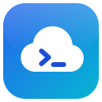
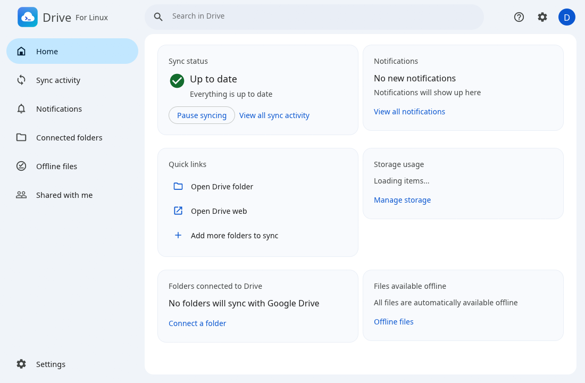

<p align="center">
  
</p>

<h1 align="center">Drive For Linux</h1>

<p align="center">
  Keep your Google Drive files on your Linux computer — streamed or mirrored, with sync status right in your file manager.
  <br>
  <b>English</b> · <a href="README.vi.md">Tiếng Việt</a>
</p>

<p align="center"></p>

> **Independent project.** Drive For Linux is not made, endorsed or supported by Google. It talks to
> Google Drive through [rclone](https://rclone.org) using your own sign-in. "Google Drive" is a
> trademark of Google LLC and is used here only to name the service the app connects to.

## What it does

- **Two ways to keep My Drive on your computer**
  - **Stream files**: your Drive appears as a folder (`~/GoogleDrive-<account>`); files download when you open them and stay in a local cache.
  - **Mirror files**: a real two-way copy in a folder you choose. Deleted files go to the desktop trash or Drive's trash (kept 30 days); when both sides changed, this computer's copy is moved to *Lost and Found* and Drive's copy is kept.
- **Back up folders from your computer** (Documents, Pictures, USB drives, network folders) to Drive and/or Google Photos, with an offer to back up a USB device when you plug it in.
- **Shared drives**: streamed together with My Drive, or mirrored one by one.
- **Up to 4 Google accounts**, each with its own settings.
- **File manager integration** (Dolphin and GNOME Files): right-click *Copy link*, *Share*, *Manage versions*, *Open with Google Drive*, *Available offline* / *Online only*, and **sync status badges** on files (synced, syncing, can't sync, available offline, online only).
- **Shared with me**: list items others shared with you and *Add shortcut to Google Drive*.
- **Offline files**, search across your Drive, sync activity and notifications that survive restarts.
- **Ransomware protection** in Mirror mode: if many synced files are rewritten or deleted at once, syncing pauses before the damage reaches Drive, and you can restore the files or allow the changes.
- **Tray icon**: closing the window keeps the app running; pause/resume, preferences and quit from the tray.
- **Settings**: launch on login, bandwidth limits, proxy, cache size, dark mode, English or Vietnamese.
- **Diagnostics**: *Generate diagnostic info* creates a zip on your desktop with logs and settings (never your sign-in keys); verbose logging on demand.

## Requirements

- A Linux desktop (KDE Plasma and GNOME tested; X11 or Wayland via XWayland).
- [rclone](https://rclone.org/install/) 1.60 or newer (`sudo apt install rclone`). The app can also download the latest rclone for you (*Settings → Get the latest rclone*), which Google Photos backup needs.
- `curl`, `notify-send` (libnotify), `gio` (for moving deleted files to the trash) — present on most desktops.
- To build: a recent stable [Rust](https://rustup.rs) toolchain.
- Optional, for sync badges in Dolphin: `g++`, Qt 6 development files (`qt6-base-dev`) and KDE Frameworks 6 KIO (already there when Dolphin is installed). Without them the app still builds, just without Dolphin badges.
- Optional, for badges in GNOME Files: the `nautilus-python` package (`python3-nautilus`).

## Install

Ready-made packages are built by GitHub Actions for every push (download them from the run's
*Artifacts*). Pushing a version tag such as `0.1.0` (or `v0.1.0`) builds them and publishes a
GitHub release with them attached; a tag with a dash, such as `0.2.0-beta.1`, becomes a
pre-release. The tag is also the version the app shows in About ("Version: 0.1.0 (x86_64)"):

| System | Package | Install with |
|---|---|---|
| Debian 13, Ubuntu 25.04 and newer | `drive-for-linux_<version>_amd64.deb` | `sudo apt install ./drive-for-linux_*.deb` |
| Fedora 42 and newer, openSUSE Tumbleweed | `drive-for-linux-<version>-1.x86_64.rpm` | `sudo dnf install ./drive-for-linux-*.rpm` |
| Arch Linux, Manjaro, EndeavourOS | `drive-for-linux-<version>-1-x86_64.pkg.tar.zst` | `sudo pacman -U drive-for-linux-*.pkg.tar.zst` |

The packages bring in rclone and the few tools the app uses. To build them yourself on Debian/Ubuntu:
`./packaging/build-packages.sh` (packages land in `dist/`).

## Build and run

```sh
cargo build --release
./target/release/drive-linux
```

On first start the app adds itself to your applications menu (as **Drive For Linux**) and, if *Launch on login* is on, to your session's autostart. Click **Sign in** and finish signing in to Google in your browser.

Useful options:

| Option | What it does |
|---|---|
| `--background` | start hidden in the tray (used for launch on login) |
| `--screenshot <file.png>` | draw the window once, save it as a PNG and quit |
| `--view <page>` | open on `activity`, `notifications`, `folders`, `offline`, `shared` or `settings` |
| `--action <name> <path>` | run a file manager action (what the right-click menu calls) |

Only one copy runs at a time; starting it again just shows the window. When the program file is replaced by a newer build, the running app restarts into it as soon as nothing is syncing.

### Sync badges in Dolphin

The app installs a small Dolphin plugin. Dolphin only picks up new plugins when it starts with the right plugin path, which is set at login — so **sign out and back in once** after the first start. If badges ever look stale, close all Dolphin windows and open Dolphin again.

## Where things are kept

| What | Where |
|---|---|
| Settings, history, sync state | `~/.config/drive-linux/` |
| Google sign-in (tokens) | rclone's own config (`~/.config/rclone/rclone.conf`) |
| Streaming cache | `~/.cache/drive-linux/` (changeable in Settings) |
| Logs | `~/.local/share/drive-linux/Logs/` (30 files of 5 MB at most) |
| Conflicting copies | `~/.local/share/drive-linux/Lost and Found/` |
| Streaming folder | `~/GoogleDrive-<account>` (changeable in Settings) |

## Differences from Google's own app

The app follows the original desktop app's behaviour wherever it can (timings, limits, messages and rules were taken from it and are listed in [MECHANICS.md](MECHANICS.md)), but some things differ. The full, current list is in the app under **Help (?) → About**. In short:

- Sign-in and transfers go through rclone's shared Google key, so Drive may briefly refuse requests ("Quota exceeded") at busy times.
- Folders from your computer are kept under **Linux computers** in My Drive (Drive's separate *Computers* area can only be created by Google's app).
- Ransomware is detected by the app itself (Google's servers warn the original).
- *Available offline* keeps files in the cache rather than pinning them for good.
- Not available: Google Photos upload size (Storage saver), the search hotkey, Gemini, *Add shortcut* in the right-click menu, and Mac/Windows-only parts (Microsoft Office presence, Outlook and Meet add-ins, Apple Photos).

## Troubleshooting

- **"Quota exceeded" notifications**: Google is limiting rclone's shared key; the app backs off and retries on its own.
- **No badges in Dolphin**: sign out and back in once; then close and reopen Dolphin.
- **Something else**: *Help (?) → Generate diagnostic info* and look at the zip it puts on your desktop (it contains no sign-in keys).

## For developers

```sh
cargo test            # 46 automatic tests (4 more need a real account: cargo test -- --ignored)
cargo clippy --all-targets
cargo fmt
```

- `src/` — the app (egui/eframe): `engine.rs` sync engine, `mirror.rs` two-way sync planner, `badges.rs` file status server, `ransom.rs`, `diag.rs`, `filemenu.rs`, `app.rs` user interface.
- `fm-plugins/dolphin/` — the Dolphin overlay plugin (C++), built by `build.rs`.
- `MECHANICS.md` / `mechanics.json` — every value and rule taken from the original, with where it came from.

## Credits

- Interface icons: [Material Design Icons](https://fonts.google.com/icons) (Apache License 2.0).
- File transfers: [rclone](https://rclone.org) (MIT License).
- User interface: [egui / eframe](https://github.com/emilk/egui) (MIT or Apache 2.0).
- Logo: drawn for this project.
