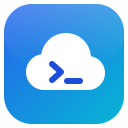
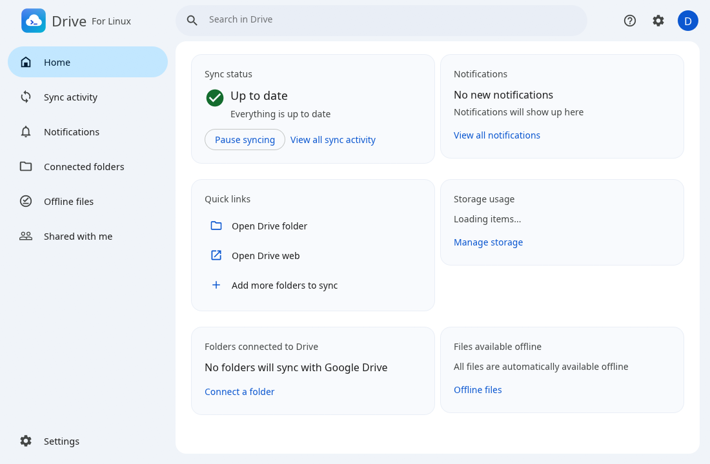

<p align="center">
  
</p>

<h1 align="center">Drive For Linux</h1>

<p align="center">
  Giữ tệp Google Drive trên máy tính Linux — truy cập trực tuyến hoặc phản chiếu, kèm biểu tượng trạng thái đồng bộ ngay trong trình quản lý tệp.
  <br>
  <a href="README.md">English</a> · <b>Tiếng Việt</b>
</p>

<p align="center"></p>

> **Dự án độc lập.** Drive For Linux không do Google làm, bảo trợ hay hỗ trợ. Ứng dụng kết nối với
> Google Drive qua [rclone](https://rclone.org) bằng chính tài khoản đăng nhập của bạn. "Google Drive"
> là nhãn hiệu của Google LLC, ở đây chỉ dùng để gọi tên dịch vụ mà ứng dụng kết nối tới.

## Ứng dụng làm được gì

- **Hai cách giữ Drive của tôi trên máy**
  - **Truy cập trực tuyến**: Drive hiện ra như một thư mục (`~/GoogleDrive-<tài khoản>`); tệp chỉ tải về khi bạn mở và được giữ trong bộ nhớ đệm.
  - **Phản chiếu**: bản sao hai chiều thật sự trong thư mục bạn chọn. Tệp bị xoá được đưa vào thùng rác của máy hoặc thùng rác của Drive (giữ 30 ngày); nếu cả hai bên cùng sửa, bản trên máy được chuyển vào *Bị thất lạc và đã tìm thấy* và giữ bản trên Drive.
- **Sao lưu thư mục trên máy** (Tài liệu, Ảnh, USB, thư mục mạng) lên Drive và/hoặc Google Photos; khi cắm USB, ứng dụng hỏi có muốn sao lưu không.
- **Bộ nhớ dùng chung**: truy cập trực tuyến cùng Drive của tôi, hoặc phản chiếu từng bộ nhớ.
- **Tối đa 4 tài khoản Google**, mỗi tài khoản có cài đặt riêng.
- **Tích hợp trình quản lý tệp** (Dolphin và GNOME Files): menu chuột phải *Sao chép đường liên kết*, *Chia sẻ*, *Quản lý phiên bản*, *Mở bằng Google Drive*, *Có thể dùng khi không có mạng* / *Chỉ trực tuyến*, và **biểu tượng trạng thái đồng bộ** trên tệp (đã đồng bộ, đang đồng bộ, không đồng bộ được, dùng khi không có mạng, chỉ trực tuyến).
- **Được chia sẻ với tôi**: xem các mục người khác chia sẻ và *Thêm lối tắt vào Google Drive*.
- **Tệp dùng khi không có mạng**, tìm kiếm trong Drive, hoạt động đồng bộ và thông báo được giữ lại sau khi mở lại ứng dụng.
- **Bảo vệ khỏi mã độc tống tiền** ở chế độ Phản chiếu: nếu nhiều tệp đã đồng bộ bị sửa hoặc xoá cùng lúc, việc đồng bộ tạm dừng trước khi thay đổi lên tới Drive; bạn có thể khôi phục tệp hoặc cho phép đồng bộ.
- **Biểu tượng ở khay hệ thống**: đóng cửa sổ thì ứng dụng vẫn chạy; tạm dừng/tiếp tục, cài đặt và thoát từ khay.
- **Cài đặt**: chạy khi đăng nhập, giới hạn băng thông, proxy, dung lượng bộ nhớ đệm, giao diện tối, tiếng Anh hoặc tiếng Việt.
- **Chẩn đoán**: *Tạo thông tin chẩn đoán* tạo tệp zip trên Màn hình nền gồm nhật ký và cài đặt (không bao giờ có khoá đăng nhập); bật ghi nhật ký chi tiết khi cần.

## Yêu cầu

- Máy Linux có giao diện đồ hoạ (đã thử với KDE Plasma và GNOME; X11 hoặc Wayland qua XWayland).
- [rclone](https://rclone.org/install/) bản 1.60 trở lên (`sudo apt install rclone`). Ứng dụng cũng có thể tự tải rclone mới nhất (*Cài đặt → Tải rclone mới nhất*), cần cho việc sao lưu Google Photos.
- `curl`, `notify-send` (libnotify), `gio` (để chuyển tệp đã xoá vào thùng rác) — hầu hết máy đều có sẵn.
- Để dựng ứng dụng: bộ công cụ [Rust](https://rustup.rs) bản ổn định mới.
- Không bắt buộc, cho biểu tượng trạng thái trong Dolphin: `g++`, tệp phát triển Qt 6 (`qt6-base-dev`) và KIO của KDE Frameworks 6 (đã có khi cài Dolphin). Thiếu chúng thì ứng dụng vẫn dựng được, chỉ không có biểu tượng trong Dolphin.
- Không bắt buộc, cho biểu tượng trong GNOME Files: gói `nautilus-python` (`python3-nautilus`).

## Cài đặt

Gói cài sẵn được GitHub Actions dựng sau mỗi lần đẩy mã (tải ở mục *Artifacts* của lần chạy) và
được đính kèm vào bản phát hành mỗi khi đẩy một thẻ `v*`:

| Hệ điều hành | Gói | Lệnh cài |
|---|---|---|
| Debian 13, Ubuntu 25.04 trở lên | `drive-for-linux_<phiên bản>_amd64.deb` | `sudo apt install ./drive-for-linux_*.deb` |
| Fedora 42 trở lên, openSUSE Tumbleweed | `drive-for-linux-<phiên bản>-1.x86_64.rpm` | `sudo dnf install ./drive-for-linux-*.rpm` |
| Arch Linux, Manjaro, EndeavourOS | `drive-for-linux-<phiên bản>-1-x86_64.pkg.tar.zst` | `sudo pacman -U drive-for-linux-*.pkg.tar.zst` |

Các gói tự cài kèm rclone và vài công cụ ứng dụng cần. Muốn tự dựng gói trên Debian/Ubuntu:
`./packaging/build-packages.sh` (gói nằm trong thư mục `dist/`).

## Dựng và chạy

```sh
cargo build --release
./target/release/drive-linux
```

Ở lần chạy đầu, ứng dụng tự thêm vào menu ứng dụng (tên **Drive For Linux**) và, nếu bật *Chạy khi đăng nhập*, vào danh sách tự khởi động. Bấm **Đăng nhập** và hoàn tất đăng nhập Google trong trình duyệt.

Các tuỳ chọn hữu ích:

| Tuỳ chọn | Tác dụng |
|---|---|
| `--background` | khởi động ẩn dưới khay hệ thống (dùng khi chạy lúc đăng nhập) |
| `--screenshot <tệp.png>` | vẽ cửa sổ một lần, lưu thành ảnh PNG rồi thoát |
| `--view <trang>` | mở ở trang `activity`, `notifications`, `folders`, `offline`, `shared` hoặc `settings` |
| `--action <tên> <đường dẫn>` | chạy một thao tác của menu chuột phải |

Mỗi lúc chỉ chạy một bản; mở lại thì chỉ hiện cửa sổ đang chạy. Khi tệp chương trình được thay bằng bản dựng mới hơn, ứng dụng đang chạy tự chuyển sang bản mới ngay khi không còn gì đang đồng bộ.

### Biểu tượng trạng thái trong Dolphin

Ứng dụng cài một plugin nhỏ cho Dolphin. Dolphin chỉ nhận plugin mới khi được mở với đường dẫn plugin đúng, mà đường dẫn này được đặt lúc đăng nhập — vì vậy **hãy đăng xuất rồi đăng nhập lại một lần** sau lần chạy đầu. Nếu biểu tượng có vẻ không cập nhật, hãy đóng hết cửa sổ Dolphin rồi mở lại.

## Dữ liệu được lưu ở đâu

| Nội dung | Vị trí |
|---|---|
| Cài đặt, lịch sử, trạng thái đồng bộ | `~/.config/drive-linux/` |
| Đăng nhập Google (khoá truy cập) | tệp cấu hình riêng của rclone (`~/.config/rclone/rclone.conf`) |
| Bộ nhớ đệm khi truy cập trực tuyến | `~/.cache/drive-linux/` (đổi được trong Cài đặt) |
| Nhật ký | `~/.local/share/drive-linux/Logs/` (tối đa 30 tệp, mỗi tệp 5 MB) |
| Bản bị xung đột | `~/.local/share/drive-linux/Lost and Found/` |
| Thư mục truy cập trực tuyến | `~/GoogleDrive-<tài khoản>` (đổi được trong Cài đặt) |

## Khác biệt so với ứng dụng của Google

Ứng dụng làm theo cách hoạt động của ứng dụng gốc ở mọi chỗ có thể (thời gian, giới hạn, thông báo và quy tắc đều lấy từ bản gốc và được ghi trong [MECHANICS.md](MECHANICS.md)), nhưng có vài điểm khác. Danh sách đầy đủ, luôn cập nhật nằm trong ứng dụng ở **Trợ giúp (?) → Giới thiệu**. Tóm tắt:

- Đăng nhập và truyền tệp đi qua khoá Google dùng chung của rclone, nên lúc đông người dùng, Drive có thể tạm từ chối yêu cầu ("Quota exceeded").
- Thư mục trên máy được lưu trong **Linux computers** của Drive của tôi (khu vực *Máy tính* riêng chỉ ứng dụng của Google tạo được).
- Mã độc tống tiền do chính ứng dụng phát hiện (bản gốc được máy chủ Google cảnh báo).
- *Có thể dùng khi không có mạng* giữ tệp trong bộ nhớ đệm chứ không ghim vĩnh viễn.
- Chưa có: kích thước tải lên của Google Photos (Tiết kiệm bộ nhớ), phím tắt tìm kiếm, Gemini, *Thêm lối tắt* trong menu chuột phải, và các phần chỉ có trên Mac/Windows (hiện diện trong Microsoft Office, tiện ích Outlook và Meet, Apple Photos).

## Khắc phục sự cố

- **Thông báo "Quota exceeded"**: Google đang giới hạn khoá dùng chung của rclone; ứng dụng tự giãn nhịp và thử lại.
- **Không thấy biểu tượng trong Dolphin**: đăng xuất rồi đăng nhập lại một lần; sau đó đóng và mở lại Dolphin.
- **Lỗi khác**: *Trợ giúp (?) → Tạo thông tin chẩn đoán* và xem tệp zip được tạo trên Màn hình nền (tệp này không chứa khoá đăng nhập).

## Dành cho nhà phát triển

```sh
cargo test            # 46 bài kiểm tra tự động (4 bài nữa cần tài khoản thật: cargo test -- --ignored)
cargo clippy --all-targets
cargo fmt
```

- `src/` — ứng dụng (egui/eframe): `engine.rs` bộ máy đồng bộ, `mirror.rs` lập kế hoạch đồng bộ hai chiều, `badges.rs` máy chủ trạng thái tệp, `ransom.rs`, `diag.rs`, `filemenu.rs`, `app.rs` giao diện.
- `fm-plugins/dolphin/` — plugin biểu tượng cho Dolphin (C++), được dựng bởi `build.rs`.
- `MECHANICS.md` / `mechanics.json` — mọi giá trị và quy tắc lấy từ bản gốc, kèm nguồn.

## Ghi công

- Biểu tượng giao diện: [Material Design Icons](https://fonts.google.com/icons) (giấy phép Apache 2.0).
- Truyền tệp: [rclone](https://rclone.org) (giấy phép MIT).
- Giao diện: [egui / eframe](https://github.com/emilk/egui) (MIT hoặc Apache 2.0).
- Logo: vẽ riêng cho dự án này.
